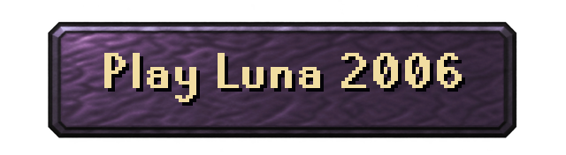

We build Luna, an open-source RuneScape server bringing 2006-era gameplay to life with autonomous player bots.

Our bots train skills, trade, fight, and progress alongside players, helping create a world with an active community and economy.

## Our projects

- **[Luna](https://github.com/luna-rs/luna)** — Our revision 377 server, built with Java and Kotlin.
- **[Luna Client](https://github.com/luna-rs/luna-client)** — The shared desktop and browser client for Luna.

## Get involved

Explore the source, report bugs, suggest features, or contribute code. Whether you enjoy building game systems or simply exploring classic RuneScape, you're welcome here.

**[Getting started](https://github.com/luna-rs/luna/wiki)** · **[Discord](https://discord.gg/PyMpDMqp4j)**

**Luna 2006** is a free-to-play actively hosted 2006-era experience based on this organization's project. Come see the 
gameplay for yourself!

- 5x experience for players, 1x experience for bots
- Standard economy, no item spawns
- No character/economy wipes or resets
